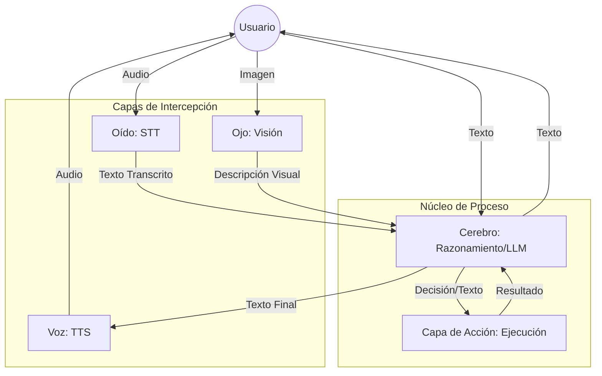

# Arquitectura del Sistema (Architecture)

## Concepto: El Orquestador

Jarvis no es un modelo único, sino un **Orquestador** que coordina cuatro inteligencias especializadas para optimizar coste y latencia, manteniendo una identidad coherente.

## Las 4 Capas de Inteligencia

### 1. El Cerebro (Razonamiento y Personalidad)

El "yo consciente". Entiende intenciones y decide acciones sin ejecutar nada directamente. Recibe siempre texto (directo o transcrito). Mantiene la coherencia y el tono "Iron Man".

### 2. Capa de Escucha (STT - Speech to Text)

Convierte audio en texto de forma eficiente. El Cerebro nunca "oye" el audio crudo, solo procesa la transcripción generada por este módulo especializado.

### 3. Capa de Habla (TTS - Text to Speech)

Convierte las decisiones del Cerebro en audio natural. El Cerebro piensa en texto, la Voz lo vocaliza para dar la sensación de una conversación viva.

### 4. Capa de Visión

Convierte frames visuales o imágenes en descripciones estructuradas. El Cerebro "ve" a través de los informes descriptivos del Ojo.

---

## Separación de Responsabilidades

### Seguridad y Ejecución

Para garantizar la seguridad, el Cerebro (LLM) **nunca** ejecuta código directamente.

- El Cerebro propone una acción.
- El **Action Layer** valida la acción, verifica permisos y la ejecuta de forma controlada.

### Escalabilidad

El sistema está diseñado como microservicios stateless. La separación de las 4 inteligencias permite escalar solo el módulo necesario (ej. escalar STT si hay mucha carga de voz) sin afectar al núcleo de razonamiento.
