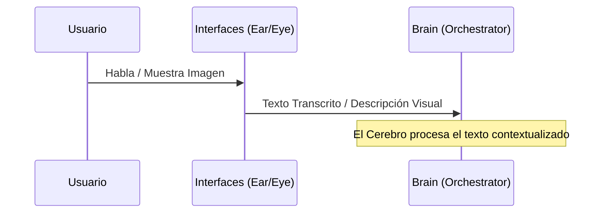
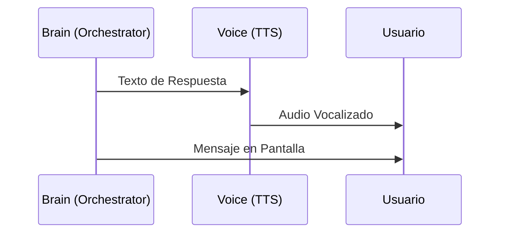

# Flujo de Datos (Data Flow)

El flujo de información en Jarvis sigue un camino estructurado para mantener la ilusión de una sola inteligencia.

## 1. Flujo de Entrada (Input)

## 2. Flujo de Decisión (Reasoning)

1. **Detección de Intención**: El Cerebro analiza el texto y decide si es una consulta o una orden.
2. **Propuesta de Acción**: Si es una orden, genera una llamada a herramienta (Tool Call).
3. **Ejecución**: El Action Layer ejecuta la tarea y devuelve el resultado al Cerebro.

## 3. Flujo de Salida (Output)

## Manejo de Errores

Si una de las capas falla (ej. STT no entiende), Jarvis responde de forma humana:
*"Lo siento, Sir, hay demasiada interferencia en la línea. ¿Podría repetir eso?"*
Nunca se muestra un error técnico crudo al usuario.
